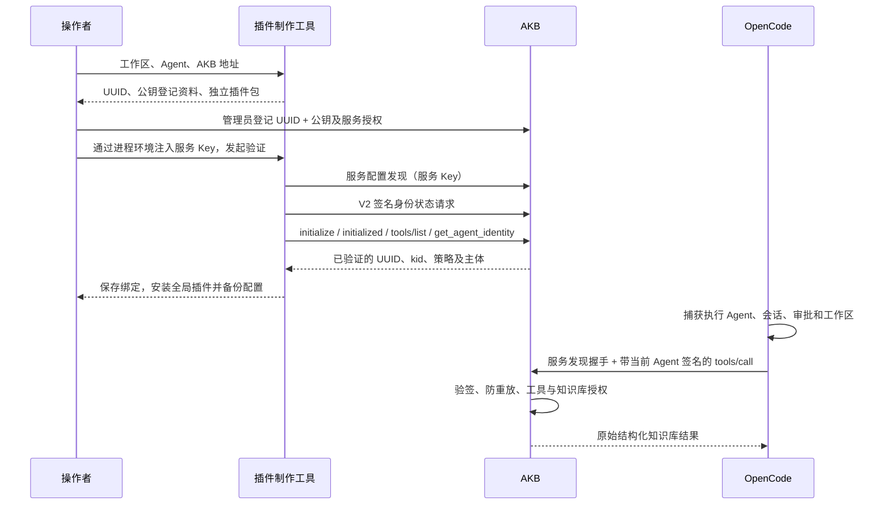

# AKB 插件方案与原代码改进

## 原问题与处理

| 问题 | 影响 | 本分支改进 |
| --- | --- | --- |
| 本机 `X-Agent-Proof` 与 AKB 协议不同 | 无法通过 AKB V2 验签 | 独立 AKB SDK 模块，不更改本机演示协议 |
| detect 和 lab 引用仓库外固定目录 | 独立克隆不能启动、测试或生成 | 内置演示运行时，保留原 LICENSE，去掉固定相邻目录依赖 |
| 原生成入口导入 Studio 所在机器的绝对路径 | ZIP 换目录后无法独立运行 | 完整复制 AKB 运行时与 SDK，使用相对模块导入和受保护配置定位 |
| 只生成 UUID/公钥不足以完成生产接入 | 不知道 AKB 策略与主体坐标 | 服务配置发现 → 签名身份确认 → 完整 MCP 握手与身份工具核对 → 保存绑定 |
| 静态 MCP 配置没有本次执行 Agent | 容易让全部请求使用同一身份 | 自定义工具捕获 host Agent/session/source，模型参数不参与选身份 |
| 两代审批与会话 API 不同 | Promise/Effect 混用、上下文丢失或错误会话目录 | 分开的两代入口，权限失败和未知能力拒绝，V2 动态查询会话目录 |
| 全局配置覆盖、重复插件与 JSONC 损坏 | 原模型/权限/注释丢失，升级重复注册 | JSONC 定点修改、原文备份、受锁保护写入、托管 URI 替换 |
| 原 startsWith 路径包含判断不准确 | 相似路径误判 | 使用相对路径和真实路径，拒绝工作区内的身份材料 |
| 仅 Host 校验不足以保护本地管理写入 | 跨站网页可能触发制作/安装 | POST Origin、Sec-Fetch-Site、JSON Content-Type 校验 |
| 任务结果带 ZIP Buffer | 大量无用 JSON，可能混入用户显式打包的材料 | 任务 JSON 不返回 ZIP 字节；独立二进制下载，AKB ZIP 固定排除密钥 |

## 对象与流程

一个受保护配置对应一个 AKB 连接和一个工作区；每个 OpenCode Agent 对应独立 UUID、私钥和 AKB 公钥登记。服务 Key 属于连接，通过指定环境变量注入；不会写进插件或 OpenCode 配置。

V2 证明的信任主体是 AKB 已登记的 UUID/公钥绑定；`terminal_agent` 是受宿主签名的诊断名称，不被当成独立授权。UUID 不是秘密或认证因子。AKB `SERVICE_SCOPE` 下各 Agent 仍共享服务授权范围；需要逐 Agent 隔离时由 AKB 的授权策略实现，客户端不能伪造额外权限。

## 安装和生命周期

- 身份材料在工作区外、当前账号控制的目录。新制作使用新目录，不覆盖已有私钥。
- 插件目录可移动，通过受保护的配置定位文件绑定实际私钥配置。无私钥 ZIP 能移动代码，不能冒充迁移身份。
- 首次或密钥变更后运行 verify；服务端 UUID、kid、ACTIVE 状态和身份工具结果必须匹配才能保存绑定。已撤销或无登记的密钥不能靠本机生成资料通过。
- 全局安装保留已有插件、模型及非 AKB 权限；备份包含原 JSONC 注释。自己管理的旧 URI 被替换，防止重复注册。安装后重启宿主。需要回滚时核对备份与当前文件的后续变更再恢复。
- 不在多 Agent 间复用可变签名人或会话。每次工具执行重新读取受保护映射及当前服务 Key，每次签名使用新 jti。
- 审批期间服务坐标、Agent 映射或默认知识库变更会要求重新审批；审批被拒、取消或工作区不符时不发送业务调用；不自动退回无 Agent 身份的服务调用，也不提供通用任意 MCP 工具执行入口。
- 只对 AKB 的无状态 JSON Streamable HTTP 提供适配；不是 OAuth、SSE 或任意 MCP 服务认证的通用适配器。

## 验证边界

本地测试使用合成服务 Key 和本地 HTTP 服务验证完整调用；另用 AKB 原 Java 类验证协议互操作。没有真实 AKB 地址、服务 Key 和生产知识库时，不声称完成线上知识库验收。宿主上下文测试使用正式 SDK 和模拟上下文，未驱动真实模型会话。Windows ACL 和两代真实宿主仍应在目标终端/CI 验收。
