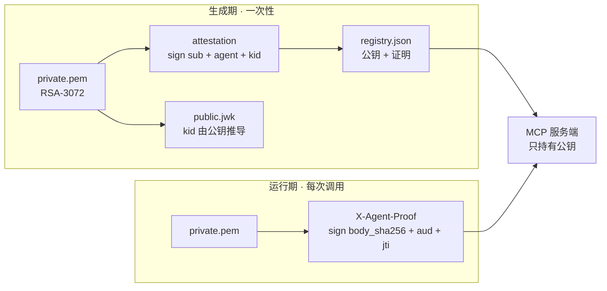
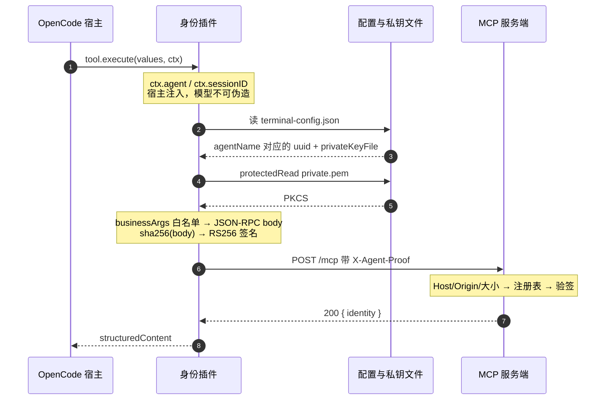
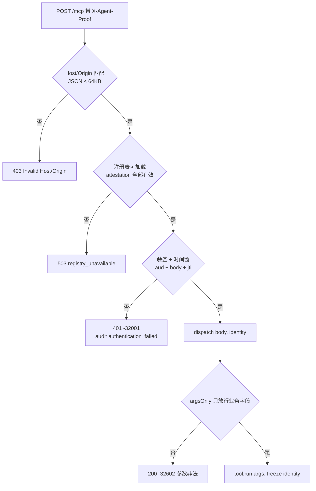
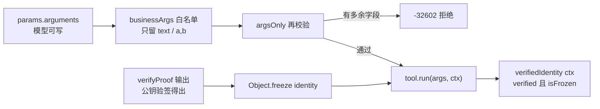

# 身份认证协议（Identity Protocol）

> 讲清楚一件事：**一次工具调用，凭什么能被证明是某个 Agent 发的，而不是别人冒名的。**
> 安装与配置见 [PLUGIN-INSTALL.md](PLUGIN-INSTALL.md)；本文只讲协议与实现，每一处都标了源码位置。
>
> 文中 token、UUID、kid、耗时均为本机实跑输出（Windows / Node 22 / OpenCode 2.2.5），只含公开材料。

---

## 0. 三句话

| # | 结论 | 落点 |
|---|---|---|
| 1 | 插件**不发送身份字段**，它发送的是对**本次请求体**的签名（JWT 形状，放在 `X-Agent-Proof` 头里）。身份只是签名载荷里的 `sub` / `agent` / `kid` | `vendor/identity-lab/lib/proof.mjs:13` `makeProof()` |
| 2 | 身份来源是**宿主进程注入的执行上下文** `ctx.agent`，不是模型说的话、不是工具参数、不是配置文件猜的。配置只负责把 `agentName → uuid + 私钥路径` 对上 | `vendor/identity-lab/lib/opencode-plugin-v2.mjs:25` `captureExecution()` |
| 3 | 服务端**不读**请求里的身份，它用 `registry.json` 的公钥 + 自己算的 body 哈希验签，把验出来的身份**冻结后注入**工具上下文。工具方法不自己去取 | `apps/mcp-server/lib/server.mjs:164` `verifyProof()` → `:114` |

一句话链：`ctx.agent` → 查配置拿私钥 → 对 body 签名 → 服务端用公钥验签 → `identity` 进 `context`。

---

## 1. 参与者与两份材料

| 材料 | 内容 | 谁持有 | 生命周期 |
|---|---|---|---|
| `private.pem` | RSA-3072 私钥（PKCS#8） | 只在**本机**身份目录 | 长期，永不外传 |
| `public.jwk` | 公钥 JWK，`kid = base64url(sha256(JSON.stringify({e,kty,n})))` | 共享 | 长期 |
| **attestation** | 用私钥对 `{v,iss,sub,agent,kid,iat}` 的签名 | 写进 `registry.json` | 长期，身份绑定 |
| **proof** | 用私钥对单次请求 `{…,body_sha256,jti,exp}` 的签名 | 只出现在 HTTP 头 | **30 秒**，一次性 |
| `registry.json` | 每个 Agent 一行：`uuid / agentName / kid / publicJwk / enabled / attestation` | 服务端 | 长期，可热更新 |
| `terminal-config.json` | `serverUrl` + `workspaceRoot` + `agentName → uuid + privateKeyFile` | 插件 | 长期 |

**为什么是两份材料**：attestation 解决「名字和公钥是不是一对」（防偷换注册表），proof 解决「这次请求是不是那个人发的」（防重放、防改包）。少任何一个都有洞。



---

## 2. 全链路时序



对应实现（以 2.x 为例，1.x 同逻辑不同外壳）：

| 步 | 做的事 | 代码 |
|---|---|---|
| 1 | 捕获宿主身份与会话，校验 agent 名格式、拿到取消信号 | `opencode-plugin-v2.mjs:25` → `opencode-compat.mjs:13` |
| 2 | `agentName` 查配置，得到 `uuid` 与私钥路径；未注册直接抛错 | `opencode-plugin-v2.mjs:28` |
| 3 | 复核工作区：`ctx.session.get()` 后 `realpath` 必须等于 `config.workspaceRoot` | `:31-32` |
| 4 | 权限审批（2.x `ctx.permission.assert`，1.x `context.ask`） | `:33` / `opencode-plugin.mjs:20` |
| 5 | 参数白名单 + 组 JSON-RPC body（`id` 随机 UUID） | `opencode-compat.mjs:24`、`client.mjs:19` |
| 6 | 读私钥：绝对路径、`O_NOFOLLOW`、≤1 MB、不在工作区内、Windows ACL 仅本人 | `client.mjs:20` → `files.mjs:10` → `protection.mjs:23` |
| 7 | 算 `sha256(body)`，生成 claims，RS256 签名 | `proof.mjs:13-20` |
| 8 | `POST` 只加一个头 `X-Agent-Proof`，`redirect:'error'`，10 s 超时 | `client.mjs:21` |
| 9 | 服务端加载注册表 → 验签 → 得到 `identity` | `server.mjs:156-174` |
| 10 | `dispatch(body, identity)`，工具经 `Object.freeze({identity})` 拿到身份 | `server.mjs:114` |

> 私钥**不是**常驻内存：只有第 6 步临时读取，用完即释放。代价是每次调用多一次磁盘读 + ACL 校验（Windows 上要 spawn PowerShell），这也是实测 `verify-agent` 约 180 ms 而纯签名只有几毫秒的原因。

---

## 3. 请求 token 逐字段

真实一次 `whoami` 调用的 token（1139 字符，签名 384 字节）：

```text
HEADER {"alg":"RS256","typ":"mcp-agent-proof+jwt","kid":"7mkaMZWtQkhEDvVopMeZBYEDD0Wmu7dF9tqU3dCxp8o"}

CLAIMS {"ver":1,
        "sub":"a8c58691-ce0f-425d-af1b-0e00158c5147",
        "agent":"build",
        "aud":"http://127.0.0.1:8781/mcp",
        "iat":1793539054,"exp":1793539084,
        "jti":"781d4658-983d-43b6-a913-4b8f9dd40da8",
        "session_id":"ses_demo",
        "invocation_id":"22222222-2222-4222-8222-222222222222",
        "method":"POST","path":"/mcp",
        "body_sha256":"4893c49688b889892e229b3a8d21f85381ef16620cbf63dcb28692677cb98bac"}
```

| 字段 | 值 | 谁写入 | 服务端怎么用 | 被改会怎样 |
|---|---|---|---|---|
| `ver` | `1` | 插件 | 必须等于 1 | `PROOF_VERSION` |
| `sub` | Agent UUID | 配置 | **主键**，去注册表查这一行 | `PROOF_UNKNOWN_AGENT` |
| `agent` | `build` | `ctx.agent` | 必须与注册表该行 `agentName` 相同 | `PROOF_AGENT_MISMATCH` |
| `aud` | `http://127.0.0.1:8781/mcp` | `serverUrl` | 必须等于本次请求的端点 | `PROOF_AUDIENCE` |
| `iat` / `exp` | 秒级时间戳，差 30 | 本机时钟 | `exp>now`、`iat≤now+5`、`0<exp-iat≤30` | `PROOF_EXPIRED` / `PROOF_NOT_YET_VALID` |
| `jti` | 随机 UUID | 每次生成 | 进重放表，`sub:kid:jti` 唯一 | `PROOF_REPLAY` |
| `session_id` | 宿主 sessionID | `ctx.sessionID` | 只做审计与长度校验（1–128） | `PROOF_SESSION` |
| `invocation_id` | 每次调用一个 | 插件 | 贯穿审计日志 | `PROOF_INVOCATION` |
| `method` / `path` | `POST` / `/mcp` | 固定 | 与实际请求比对 | `PROOF_METHOD` / `PROOF_PATH` |
| `body_sha256` | 本次 body 的 hex 摘要 | 先算 body 再签 | 对**原始字节**重算后比对 | `PROOF_BODY` |

token 里**故意没有**：私钥、权限范围、注册表、调用者 IP。权限由宿主审批和服务端工具白名单负责，跟身份证明分开。

两个编码细节，自己实现客户端时必须对齐：

- 全链路 `base64url` **无 padding**；`kid` 的 JSON 键序固定为 `{e,kty,n}`，否则和服务端算出的不一致。
- **proof 用原始 token 段验签**（不重新序列化），所以字节必须原样保留；**attestation 验签前会 `canonicalJSON()` 排序键**（`canonical.mjs:18`），所以它对键序不敏感。

还有一处顺序很关键：服务端**先验签、后 `JSON.parse`**（`server.mjs:164` 在 `:177` 之前）。body 是未解析的 `Buffer`，解析失败也进不到工具层。

---

## 4. 服务端四道闸门



`verifyProof()`（`packages/identity-sdk/src/proof.mjs:143-206`）内部的完整校验顺序，失败一律抛 `AUTH_FAILED`，细节看 `error.code`：

| # | 检查 | 失败 code |
|---|---|---|
| 1 | token 存在、≤8192 字符、恰好 3 段且都是 base64url | `PROOF_MALFORMED` |
| 2 | header `alg=RS256`、`typ=mcp-agent-proof+jwt` | `PROOF_ALG` |
| 3 | claims `ver=1`、`sub` 是 UUID、`agent` 匹配 `[A-Za-z0-9_.:-]{1,128}` | `PROOF_VERSION` / `PROOF_UUID` / `PROOF_AGENT` |
| 4 | 注册表能查到 `sub`，且 `enabled === true` | `PROOF_UNKNOWN_AGENT` / `PROOF_DISABLED` |
| 5 | 注册表该行 `agentName` 与 claims 一致 | `PROOF_AGENT_MISMATCH` |
| 6 | 注册表 `kid` = header `kid`，且**本地重算** kid 也一致 | `PROOF_KID_MISMATCH` |
| 7 | 用注册表公钥 `RSA-SHA256` 验签 | `PROOF_SIGNATURE` |
| 8 | `exp > now`、`iat ≤ now+5s`、`0 < exp-iat ≤ 30s` | `PROOF_EXPIRED` / `PROOF_NOT_YET_VALID` / `PROOF_TIME` |
| 9 | `aud` 等于本端点、`method`、`path === '/mcp'` | `PROOF_AUDIENCE` / `METHOD` / `PATH` |
| 10 | `body_sha256` 等于服务端对原始字节的哈希 | `PROOF_BODY` |
| 11 | `jti`、`invocation_id` 是 UUID，`session_id` 长度 1–128 | `PROOF_JTI` / `INVOCATION` / `SESSION` |
| 12 | `sub:kid:jti` 未出现过（重放表，按 `exp` 清理，上限 1 万） | `PROOF_REPLAY` |

第 4 步的 `resolveAgent` 只接受 `uuid => registry.agents.find(...)`（`server.mjs:165`），请求里自述的任何东西都进不来。

---

## 5. identity 如何到达工具



```js
// apps/mcp-server/lib/server.mjs:86-119
const data = tools[params.name].run(params.arguments ?? {}, Object.freeze({ identity }));

function verifiedIdentity(context) {          // 工具唯一的身份入口
  if (!context?.identity?.verified || !Object.isFrozen(context.identity))
    throw new Error('Verified request identity required');
  return context.identity;
}

function argsOnly(args, fields) {              // 有任一字段不在白名单就抛错
  if (!object(args) || Object.keys(args).some(key => !fields.includes(key)))
    throw new Error('Invalid tool arguments; identity comes from the server context');
}
```

工具实现因此可以短到一行，且**完全不碰文件、注册表、环境变量**：

```js
whoami: { schema: { type: 'object', properties: {}, additionalProperties: false },
  run(args, context) { argsOnly(args, []); return { identity: verifiedIdentity(context) }; } }
```

`argsOnly(args, [])` 意思是一个参数都不接受。实测三种绕过尝试：

```text
参数里塞 identity  → HTTP 200，{"code":-32602,"message":"Invalid tool arguments; identity comes from the server context"}
签名 A 发出 B      → HTTP 401，{"code":-32001,"message":"Agent authentication failed"}
同一 token 发两次  → 第一次 200，第二次 401
```

第一条是 HTTP 200 而不是 401 —— 身份认证**通过了**，是工具层拒绝的入参，这个区分在排障时很有用。

---

## 6. 攻击面与对应防线

| 攻击 | 被谁挡住 | 实测结果 |
|---|---|---|
| 参数里塞 `identity` | `businessArgs` 白名单 + `argsOnly` | 200 / `-32602` |
| 改 body（换工具名、改参数） | `body_sha256`（第 10 项） | 401 / `-32001` |
| 重放同一 token | `jti` 重放表（第 12 项） | 第二次 401 |
| 改 token 里的 `agent` 名 | 注册表比对 + 验签（第 5、7 项） | 401 |
| 偷换注册表里的名字或公钥 | attestation 验签（加载期） | 503，拒绝加载 |
| 把 token 用到别的端口/机器 | `aud` + `assertLocalEndpoint` | 401 |
| 时间回拨 / 过期 token | `exp` / `iat ± 5s` | 401 |
| 撤销某个 Agent | 注册表 `enabled:false` | 401，**无需重启** |
| 外部进程直接打服务端 | 没有私钥 → 签不出 → 401 / Host 403 | 见 §10 |

真正的信任根只有一条：**私钥的可读性**。能读到 `private.pem` 的进程就能代表该 Agent 签名，所以 Windows ACL / POSIX `0600` + 「身份目录必须在工作区之外」是整套机制的前提。

---

## 7. 生命周期

| 阶段 | 动作 | 生效方式 |
|---|---|---|
| 生成 | `createAgentIdentity()` 出密钥对 + UUID + attestation | 写 `registry.json` / `terminal-config.json` |
| 注册 | `validateRegistry(..., {requireAttestation:true})` | 逐条验 attestation，失败不让写 |
| 运行 | 每次调用现签 proof | 30 秒有效，一次性 |
| 撤销 | 改 `enabled:false` | 下一个请求即拒（注册表热加载） |
| 轮换 | 重新生成该 Agent 身份并替换注册表行 | 旧 token 立即失效（kid 变了） |

注册表缓存键是 `mtimeMs:size:ino`（`server.mjs:37`），所以改文件**不用重启**；`/health` 会返回每个 Agent 的 `attestation` 状态（`verified` / `absent` / `invalid`），可直接当健康检查用。

---

## 8. 两代宿主的差异

| 项 | OpenCode 2.x | OpenCode 1.x |
|---|---|---|
| 入口 | 目录 + `package.json`，`export default {setup}` | 单文件 `default entry(input, options)` |
| 工具注册 | `ctx.tool.transform(editor => editor.add({...}))` | `tool({ description, args, execute })` |
| 身份来源 | `context.agent` / `context.sessionID` | `context.agent` / `context.sessionID` |
| 取消信号 | `context.signal` | `context.abort` |
| 权限审批 | `ctx.permission.assert({sessionID, agent, source, action})` | `context.ask()`，兼容原生 Promise 与 Effect |
| 清理 | `setup` 返回的 async `dispose()` | 无需 |

签名、验签、注册表、注册逻辑**完全共用** `client.mjs` / `proof.mjs`，所以两代宿主的 token 可以互相验证。

---

## 9. 自己实现一个客户端

不需要插件，也不需要生成工具，20 行就能签一次请求（下面这段已实测返回 200 / `verified:true`）：

```js
import { readFile } from 'node:fs/promises';
import { randomUUID } from 'node:crypto';
import { createProof, assertLocalEndpoint, HEADER } from '@opencode-identity/sdk';

const url = assertLocalEndpoint('http://127.0.0.1:8781/mcp');
const key = await readFile('C:/Users/me/mcp-identity/agents/build/private.pem', 'utf8');

const body = Buffer.from(JSON.stringify({
  jsonrpc: '2.0', id: randomUUID(),
  method: 'tools/call', params: { name: 'whoami', arguments: {} },
}));

const proof = createProof({
  uuid: 'a8c58691-ce0f-425d-af1b-0e00158c5147', agentName: 'build',
  privateKey: key, url, body, sessionId: 'manual', invocationId: randomUUID(),
});

const res = await fetch(url, {
  method: 'POST', redirect: 'error', body,
  headers: { 'Content-Type': 'application/json', [HEADER]: proof },
});
console.log(res.status, await res.json());
```

要点只有三条：**body 必须是最终要发出去的那串字节**（先序列化再签名，别发的时候重新 `JSON.stringify`）、**`uuid` 与私钥必须配对**、**`agentName` 必须与注册表一致**。改任何一条都会拿到 401。

> 在仓库里直接跑而没装 `node_modules` 时，把 import 换成相对路径即可：
> `import { … } from './packages/identity-sdk/src/index.mjs'`（本人实测就是这么跑的）。

---

## 10. 已知边界（诚实清单）

- **私钥可读 = 身份可冒用**。协议证明的是「持有私钥的人」，不是「某个进程」。同机任何能读该文件的进程都能签，防线只有文件 ACL。
- 每次请求都重读私钥，Windows 上要 spawn PowerShell 校验 ACL，单次约 150–200 ms；这是用「私钥不长驻内存」换来的。
- 注册表缓存只比 `mtime:size:ino`。理论上「原地覆盖 + 大小不变 + mtime 毫秒级相同」可绕过，实际几乎不可能触发；介意就重启服务端。
- 重放表在内存里，重启即清空；但 `exp ≤ 30s` 仍然限制窗口。
- 只支持 `http://127.0.0.1:<port>/mcp`（`localhost` / `[::1]` 亦可），不支持 TLS、不支持远程访问——这是刻意的设计边界，不是遗漏。
- 审计输出是 stdout 一行 JSON，不落盘、不带 token 内容（只记 `code`）。
- 1.x 宿主的安装与审批写法沿用上游实现，**本机没有 1.x 环境，未实机验证**（见 PLUGIN-INSTALL 第 4.2 节）。

---

## 附 A：文件索引

| 角色 | 文件 | 关键函数 |
|---|---|---|
| 插件模板（2.x） | `vendor/identity-lab/lib/opencode-plugin-v2.mjs` | `setupV2()` |
| 插件模板（1.x） | `vendor/identity-lab/lib/opencode-plugin.mjs` | `createPlugin()` |
| 捕获宿主身份 / 参数白名单 | `vendor/identity-lab/lib/opencode-compat.mjs` | `captureExecution()` / `businessArgs()` |
| 读配置、读私钥、发请求 | `vendor/identity-lab/lib/client.mjs` | `loadTerminalConfig()` / `rpcCall()` / `callTool()` |
| 文件保护与 ACL | `vendor/identity-lab/lib/files.mjs`、`protection.mjs` | `protectedRead()` / `protectionPolicy()` |
| 请求签名与验签 | `vendor/identity-lab/lib/proof.mjs` | `makeProof()` / `verifyProof()` |
| 同名实现（SDK 版） | `packages/identity-sdk/src/proof.mjs` | `createProof()` / `verifyProof()` / `createReplayStore()` |
| 身份证明 | `packages/identity-sdk/src/identity.mjs` | `signIdentity()` / `verifyIdentity()` / `verifyEnrollment()` |
| 注册表 | `packages/identity-sdk/src/registry.mjs` | `buildEnrollment()` / `validateRegistry()` / `attestationReport()` |
| 服务端四道闸门 | `apps/mcp-server/lib/server.mjs` | `createIdentityServer()` |
| 生成编排 | `apps/plugin-studio/lib/builder.mjs` | `runBuild()` / `localizePlugin()` |

## 附 B：实测记录

| 项 | 结果 |
|---|---|
| 一次 `whoami` token | 1139 字符，签名 384 字节 |
| 参数注入 `identity` | HTTP 200 + `-32602` |
| 篡改 body 后发送 | HTTP 401 + `-32001` |
| 同一 token 重放 | 首次 200，第二次 401 |
| `verify-agent`（含 ACL 校验） | `verified:true`，约 180 ms |
| `GET /health` | `{"ok":true,…,"attestation":[{"agentName":"build","status":"verified"},{"agentName":"plan","status":"verified"}]}` |
| 最小客户端（§9） | HTTP 200，`verified:true` |
